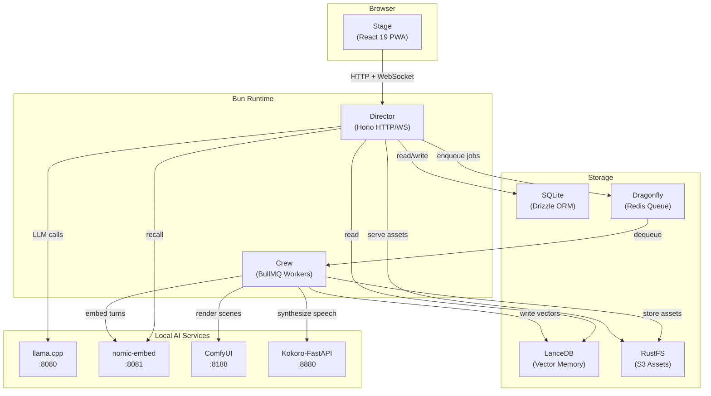

<p align="center">
  
</p>

<h1 align="center">Chronicle</h1>

<p align="center">
  <strong>A local-first interactive visual RPG — powered entirely by AI running on your own machine.</strong>
</p>

<p align="center">
  
  
  
  
  
  
</p>

<p align="center">
  <em>Build worlds. Create characters. Play through branching, narrated stories with AI-generated text, images, and voice — all offline, all yours.</em>
</p>

---

## ✨ What is Chronicle?

Chronicle is a **local-first interactive visual RPG** that runs entirely on your hardware. No cloud APIs, no subscriptions, no data leaving your machine. You craft worlds and characters, then play through branching storylines where a local LLM narrates your adventure, a diffusion model paints your scenes, and a TTS engine gives every character a voice.

### Highlights

- 🎭 **Interactive storytelling** — submit actions, pick from AI-generated choices, roll dice against skill checks
- 🖼️ **AI-generated scene art** — FLUX.2 Klein or SDXL Lightning renders each moment with character face identity preserved via PuLID
- 🗣️ **Per-character voices** — Kokoro TTS speaks narration and dialogue with distinct voices per character
- 🌳 **Branching narrative tree** — switch branches, replay from any checkpoint, explore alternate timelines
- 🧠 **Vector memory** — nomic-embed recalls earlier story events so the narrator remembers what happened 50 turns ago
- 👥 **Ensemble cast** — multiple characters speak, react, and form bonds; turn-taking weighted by eagerness and recency
- 🎨 **Deep theming** — ten built-in palettes, a full theme studio, custom saved themes with token-level control
- 📴 **Fully local** — llama.cpp, ComfyUI, Kokoro-FastAPI, Dragonfly, and RustFS all run on localhost

---

## 🏗️ Architecture

Chronicle is a **Turborepo + Bun** monorepo with three apps and three shared packages:

```
chronicle/
├── apps/
│   ├── stage/       → Vite + React 19 PWA client (browser)
│   ├── director/    → Bun + Hono HTTP/WebSocket gateway
│   └── crew/        → BullMQ worker for diffusion, TTS, and memory
├── packages/
│   ├── config/      → Constants, environment, paths
│   ├── db/          → Drizzle ORM + SQLite schema, Better Auth, LanceDB
│   └── utils/       → Domain logic, turn DAG, WS protocol, point-buy
├── scripts/         → AI server management (PowerShell)
└── public/          → Static assets (logo)
```

### Apps

| App | Package | Role |
| --- | --- | --- |
| **Stage** | `@chronicle/stage` | Vite + React 19 PWA. The player-facing browser UI with a theme engine, story canvas, dice roller, and real-time WebSocket streaming. |
| **Director** | `@chronicle/director` | Bun + Hono backend. Handles auth, REST API, WebSocket gateway, turn DAG state machine, LLM prompt orchestration, and dice adjudication. |
| **Crew** | `@chronicle/crew` | BullMQ worker pool. Processes background jobs for image diffusion (ComfyUI), text-to-speech (Kokoro), and vector memory (nomic-embed + LanceDB). |

### Packages

| Package | Scope | Purpose |
| --- | --- | --- |
| **config** | `@chronicle/config` | Runtime configuration, environment variable validation (Zod), OS-aware paths, prompt templates, image engine registry, ensemble rules, and theme palette definitions. |
| **db** | `@chronicle/db` | Drizzle ORM schema for SQLite (auth, worlds, characters, turns, settings, themes), Better Auth integration, LanceDB vector store for story memory, and migrations. |
| **utils** | `@chronicle/utils` | Pure domain functions — turn DAG traversal, WebSocket protocol types, point-buy stat allocation, ensemble turn-taking, bond tracking, attributed line parsing, and mention detection. |

---

## 🔧 Tech Stack

| Layer | Technology |
| --- | --- |
| **Runtime** | [Bun](https://bun.sh) 1.4+ |
| **Monorepo** | [Turborepo](https://turbo.build) |
| **Frontend** | [React 19](https://react.dev), [Vite](https://vite.dev), [Tailwind CSS v4](https://tailwindcss.com), [Base UI](https://base-ui.com), [Zustand](https://zustand.docs.pmnd.rs), [TanStack Query](https://tanstack.com/query), [React Router](https://reactrouter.com) |
| **Animations** | [Motion](https://motion.dev), [GSAP](https://gsap.com), [React Three Fiber](https://r3f.docs.pmnd.rs), [CanvasKit](https://skia.org/docs/user/modules/canvaskit/) |
| **Backend** | [Hono](https://hono.dev) (HTTP + WebSocket) |
| **Auth** | [Better Auth](https://better-auth.com) |
| **Database** | SQLite via [Drizzle ORM](https://orm.drizzle.team), [LanceDB](https://lancedb.com) for vectors |
| **Queue** | [BullMQ](https://bullmq.io) over [Dragonfly](https://www.dragonflydb.io) (Redis-compatible) |
| **Object Storage** | [RustFS](https://github.com/rustfs/rustfs) (S3-compatible, local) |
| **LLM** | [llama.cpp](https://github.com/ggml-org/llama.cpp) server (Qwen 3.5 9B recommended) |
| **Image Gen** | [ComfyUI](https://github.com/comfyanonymous/ComfyUI) — FLUX.2 Klein 4B / SDXL Lightning + PuLID |
| **TTS** | [Kokoro-FastAPI](https://github.com/remsky/Kokoro-FastAPI) |
| **Embeddings** | [nomic-embed-text v1.5](https://huggingface.co/nomic-ai/nomic-embed-text-v1.5) via llama.cpp |
| **Linting** | [Biome](https://biomejs.dev) |
| **Language** | [TypeScript](https://typescriptlang.org) 7+ (strict mode, ESNext target) |

---

## 🚀 Getting Started

### Prerequisites

| Requirement | Notes |
| --- | --- |
| **Bun** ≥ 1.4 | [Install Bun](https://bun.sh/docs/installation) |
| **Dragonfly** (or Redis) | In-memory datastore for BullMQ job queues |
| **RustFS** (or MinIO) | S3-compatible object storage for scene images and audio |
| **llama.cpp** | Serving a GGUF model (≥ 9B recommended) on port `8080`, embeddings on `8081` |
| **ComfyUI** | For image generation — FLUX.2 Klein or SDXL Lightning |
| **Kokoro-FastAPI** | For text-to-speech on port `8880` |
| **GPU** | NVIDIA recommended; 16 GB+ VRAM for LLM + diffusion concurrently |

### Installation

```bash
# Clone the repository
git clone https://github.com/AbdulWadudh/chronicle.git
cd chronicle

# Install dependencies
bun install

# Copy and fill in your environment variables
cp .env.example .env
# Edit .env with your local paths and secrets
```

### Configuration

The `.env` file at the repo root configures all local service endpoints:

```env
LLM_ENDPOINT=http://127.0.0.1:8080/v1      # llama.cpp server
DIFFUSION_ENDPOINT=http://127.0.0.1:8188     # ComfyUI
TTS_ENDPOINT=http://127.0.0.1:8880           # Kokoro-FastAPI
STORAGE_ENDPOINT=http://127.0.0.1:9000       # RustFS / MinIO
REDIS_URL=redis://127.0.0.1:6379             # Dragonfly / Redis
AUTH_SECRET=replace-with-at-least-32-chars   # Session signing key
```

### Starting AI Services

Chronicle ships PowerShell scripts to manage all local AI services:

```powershell
bun ai            # Start llama.cpp (LLM + embed), ComfyUI, and Kokoro
bun ai:status     # Check which services are up
bun ai:logs       # Tail all service logs
bun ai:stop       # Shut everything down
```

### Running the App

```bash
# Start all three apps (director + crew + stage) in one terminal
bun app

# Or start individually:
bun dev:director      # Hono server on :3000
bun dev:crew          # BullMQ worker
bun dev:stage         # Vite dev server on :8082 (proxies /api → director)
```

Open **http://localhost:8082** and sign in.

---

## 📜 Scripts Reference

| Command | Description |
| --- | --- |
| `bun install` | Install all workspace dependencies |
| `bun app` | Start director, crew, and stage together |
| `bun app:stop` | Stop all app servers |
| `bun app:status` | Check app server status |
| `bun app:clear` | Start with Vite dep cache cleared |
| `bun ai` | Start all local AI services |
| `bun ai:stop` | Stop all AI services |
| `bun ai:status` | Check AI service health |
| `bun ai:logs` | Tail AI service logs |
| `bun dev` | Turbo-driven parallel dev for all apps |
| `bun dev:director` | Director only with `--watch` |
| `bun dev:crew` | Crew only with `--watch` |
| `bun dev:stage` | Vite dev server for stage |
| `bun run build` | Production build across the graph |
| `bun run check` | Full audit + lint + typecheck |
| `bun run audit` | 300-line ceiling + zero-comment enforcement |
| `bun run lint` | Biome linter |
| `bun run format` | Biome auto-fix |
| `turbo run typecheck` | TypeScript check across all workspaces |

---

## 🎮 Features In Depth

### World Building
Create rich, persistent worlds with descriptions, art bibles, visual styles, and shot size preferences. Each world carries its own narrator voice and prompt, setting the tone for every story told within it.

### Character Creation
Design characters with names, pronouns, bios, appearance, outfits, backstories, and stat blocks using a point-buy system. Each character gets an AI-generated portrait with face identity locking — their face stays consistent across every scene.

### Interactive Play
Submit free-text actions or pick from three AI-generated choices each turn. The LLM narrates the outcome, dice checks resolve against character stats, and the whole exchange streams to the client in real-time over WebSockets.

### Branching & Memory
Every turn is a node in a DAG. Switch branches to explore alternate paths, jump to any checkpoint, and let vector memory recall story events from far beyond the recent history window. A rolling summariser keeps facts alive across sessions.

### Ensemble System
Enable multi-character scenes with opt-in ensemble mode. Characters speak with distinct voices and personalities, form bonds that evolve through interaction, and enter or leave scenes naturally. Turn-taking is weighted by eagerness and recency, with `@mention` support for directed conversation.

### Scene Rendering
Each narrative moment gets a painted scene via ComfyUI. FLUX.2 Klein renders at native 1.5× resolution with character portraits as identity references. Supports photoreal, anime, painterly, comic, and 3D render styles.

### Theme Studio
Ten curated palettes out of the box, plus a full theme editor with per-token control over colors, radius, shadows, and overlays. Save, rename, and share custom themes. Every component reads from theme tokens — `radius: 0` is genuinely square.

---

## 🗂️ Project Structure

```
chronicle/
│
├── apps/
│   ├── stage/                  # Browser client
│   │   ├── src/
│   │   │   ├── components/     # UI components (common, story, canvas, character, admin)
│   │   │   ├── hooks/          # React hooks (WebSocket, audio, turns, layout)
│   │   │   ├── lib/            # API client, auth, session
│   │   │   ├── routes/         # Pages (SignIn, Worlds, Characters, Play, Settings, Admin)
│   │   │   ├── theme/          # Theme store, tokens, ThemeEngine
│   │   │   └── styles/         # Global styles
│   │   ├── public/             # Static assets
│   │   └── vite.config.ts
│   │
│   ├── director/               # API gateway
│   │   └── src/
│   │       ├── engine/         # LLM prompts, compose, recall, adjudicator, appearance
│   │       ├── routes/         # REST endpoints (worlds, characters, turns, settings, voices)
│   │       └── ws/             # WebSocket gateway, sessions, streaming, media relay
│   │
│   └── crew/                   # Background workers
│       └── src/
│           └── processors/     # diffusion (ComfyUI), tts (Kokoro), memory (embed + LanceDB)
│
├── packages/
│   ├── config/src/             # env, paths, prompts, settings, palettes, image engines, ensemble
│   ├── db/src/                 # Drizzle schema, auth, migrations, memory store, accounts, themes
│   └── utils/src/              # Turn DAG, WS protocol, point-buy, ensemble logic, bond helpers
│
├── scripts/
│   ├── ai-servers.ps1          # Start/stop/status for llama.cpp, ComfyUI, Kokoro, embed
│   ├── app-servers.ps1         # Start/stop/status for director, crew, stage
│   └── audit.ts                # Line ceiling + zero-comment enforcement
│
├── turbo.json                  # Turborepo pipeline config
├── biome.json                  # Linter and formatter config
├── tsconfig.base.json          # Shared TypeScript settings
└── .env.example                # Environment variable template
```

---

## ⚙️ Code Quality

Chronicle enforces strict code quality through multiple layers:

- **300-line ceiling** — no source file may exceed 300 lines; the audit script fails the build
- **Zero-comment rule** — code must be self-documenting; comments are rejected by audit
- **Biome** — linting and formatting with strict rules (`noExplicitAny`, `noUnusedVariables`, `noNonNullAssertion`)
- **TypeScript strict mode** — `strict: true`, `noUncheckedIndexedAccess`, `verbatimModuleSyntax`
- **Turborepo** — parallel typechecking across all workspaces

Run the full suite:

```bash
bun run check    # audit + lint + typecheck
```

---

## 🌐 Service Architecture



---

## 📋 Environment Variables

| Variable | Default | Description |
| --- | --- | --- |
| `LLM_ENDPOINT` | `http://127.0.0.1:8080/v1` | llama.cpp server (OpenAI-compatible API) |
| `LLM_MODEL` | `chronicle-llm` | Model alias registered in llama.cpp |
| `DIFFUSION_ENDPOINT` | `http://127.0.0.1:8188` | ComfyUI API endpoint |
| `TTS_ENDPOINT` | `http://127.0.0.1:8880` | Kokoro-FastAPI endpoint |
| `STORAGE_ENDPOINT` | `http://127.0.0.1:9000` | S3-compatible object storage |
| `STORAGE_ACCESS_KEY` | — | S3 access key |
| `STORAGE_SECRET_KEY` | — | S3 secret key |
| `STORAGE_BUCKET_ASSETS` | `chronicle-assets` | Bucket for images and audio |
| `REDIS_URL` | `redis://127.0.0.1:6379` | Dragonfly / Redis connection |
| `AUTH_SECRET` | — | Session signing secret (≥ 32 chars) |
| `VITE_GOOGLE_FONTS_API_KEY` | — | Optional: Google Fonts API for the font picker |
| `STAGE_DIST` | — | Production only: path to pre-built stage bundle |

---

## 🧑‍💻 Development

### Adding a new workspace package

1. Create a directory under `packages/` with a `package.json` using the `@chronicle/` scope
2. Add `"typecheck": "tsc --noEmit"` to scripts
3. Reference `tsconfig.base.json` from your local `tsconfig.json`
4. Add the workspace dependency to consumers: `"@chronicle/new-pkg": "workspace:*"`

### Hot reload caveat

Bun's `--watch` does not reload an app when only a workspace package changes. Touch the app's `src/index.ts` to force a restart, or use `bun app:clear` to clear Vite's dep optimisation cache.

### Database migrations

```bash
# Generate a new migration after schema changes
bun run --filter @chronicle/db db:generate

# Apply pending migrations
bun run --filter @chronicle/db db:migrate
```

---

## 🗺️ Roadmap

| Wave | Status | Scope |
| --- | --- | --- |
| 1–6 | ✅ Done | Governance, core packages, director, crew, stage client, theme studio, admin |
| 7A–7F | ✅ Done | World/character authoring, turn play, audio, image identity, WebP assets, TanStack Query |
| 8 | ✅ Done | Narrator prompt, per-character voices, personality, ensemble cast system |
| 9 | ✅ Done | Vector memory — real embeddings, rolling summaries, recall in prompts |
| 10 | ✅ Done | Speaker treatment on screen, per-character voice assignment |
| 11 | ✅ Done | Image engine registry, FLUX.2 Klein scenes, native resolution rendering |

---

## 📄 License

This is a private project. All rights reserved.

---

<p align="center">
  <sub>Built with 🎲 by <a href="https://github.com/AbdulWadudh">Abdul Wadudh</a></sub>
</p>
